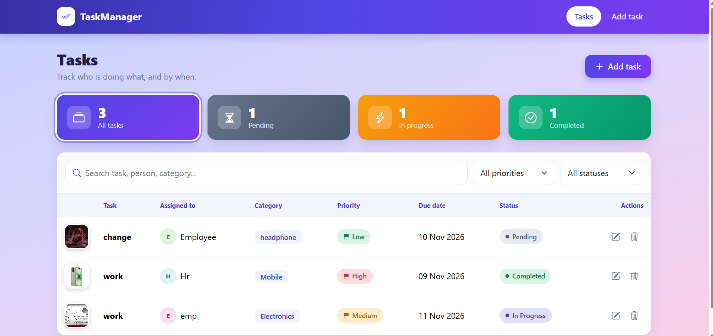
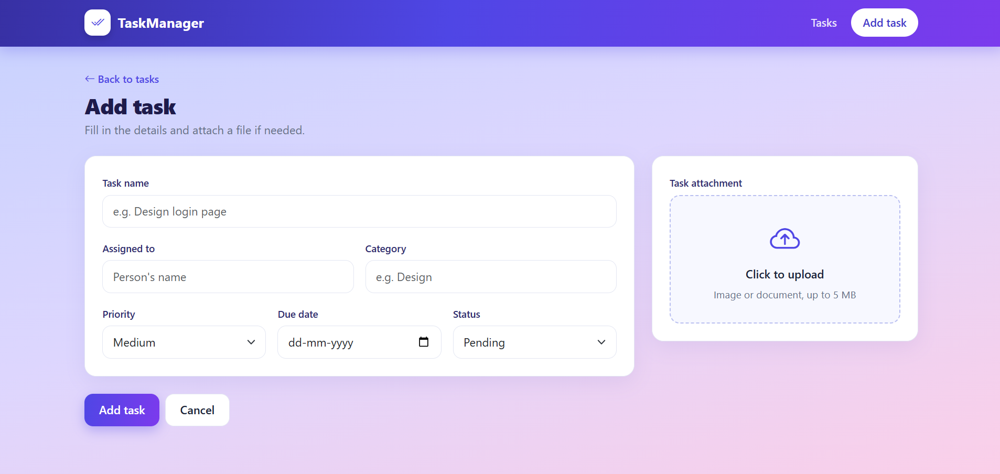
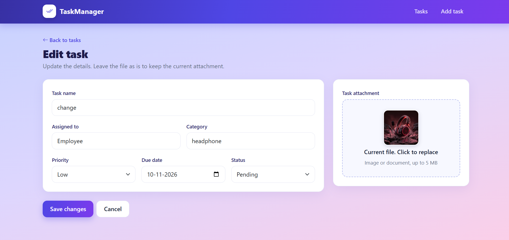
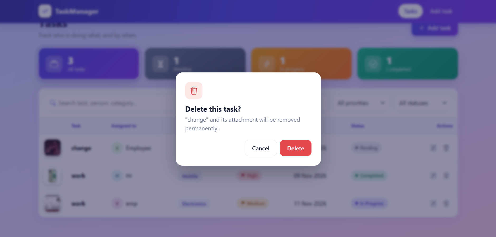
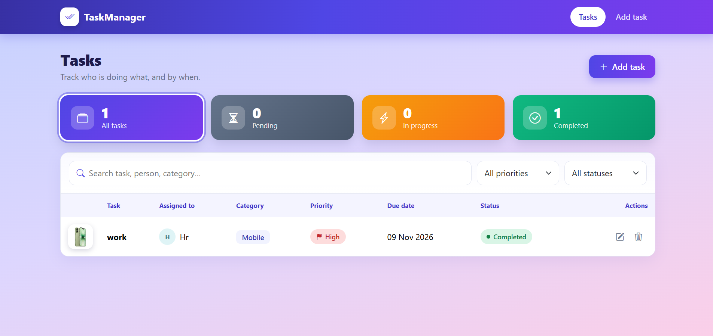

# TaskManagerApp

A full-stack Task Management application built with the MERN stack.
Users can add, view, edit and delete tasks, with an image/file attachment for each task.

## Features
- Add a task with an attachment (image or file)
- View all tasks with attachment preview
- Edit a task (keep the old attachment or upload a new one)
- Delete a task
- Search and filter by task name, assigned to, category, priority and status

## Tech Stack
**Frontend:** React (Vite), React Router DOM, Axios, Bootstrap
**Backend:** Node.js, Express, Mongoose, Multer, CORS
**Database:** MongoDB

## Folder Structure
```
TaskManager-TEST/
├── backend/
│   ├── config/        (database connection)
│   ├── controllers/   (CRUD logic)
│   ├── middleware/    (file upload)
│   ├── models/        (Mongoose schema)
│   ├── routes/        (API routes)
│   ├── uploads/       (uploaded files)
│   └── app.js
└── frontend/
    └── src/
        ├── components/
        ├── pages/
        ├── api.js
        └── App.jsx
```

## Setup

### 1. Backend
```bash
cd backend
npm install
```
Create a `.env` file inside `backend`:
```
PORT=5000
MONGO_URI=mongodb://127.0.0.1:27017/taskmanager
```
Start the server:
```bash
npm run dev
```
Runs on http://localhost:5000

### 2. Frontend
```bash
cd frontend
npm install
npm run dev
```
Runs on the URL shown in the terminal (usually http://localhost:5173).

## API Endpoints
| Method | Endpoint         | Description        |
|--------|------------------|--------------------|
| GET    | /api/tasks       | Get all tasks      |
| GET    | /api/tasks/:id   | Get one task       |
| POST   | /api/tasks       | Add a task         |
| PUT    | /api/tasks/:id   | Update a task      |
| DELETE | /api/tasks/:id   | Delete a task      |

## Screenshots
### Task List


### Add Task


### Edit Task


### Delete Confirmation


### Delete Confirmation


### Search

